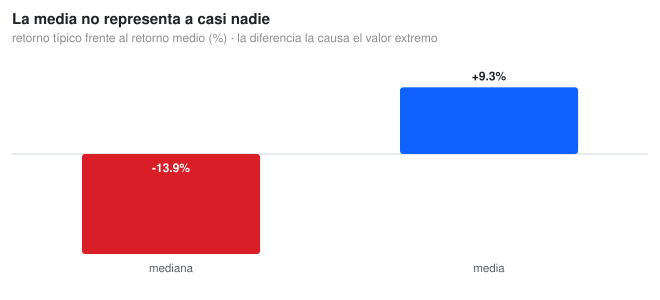
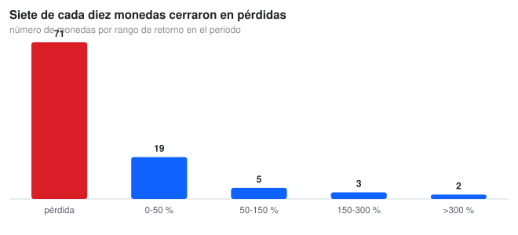
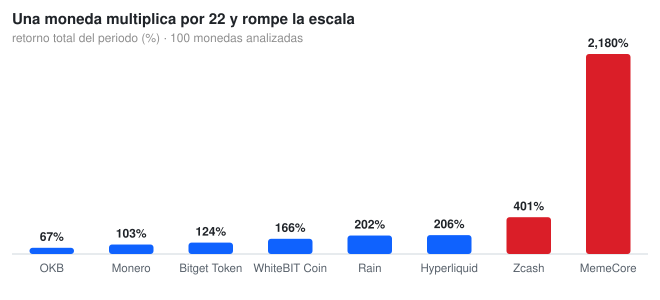

# 📊 Crypto Medallion Analytics

**Medallion Architecture for DeFi | PySpark | MLflow | Power BI Dashboard**

[](https://fabric.microsoft.com/)
[](https://spark.apache.org/)
[](https://mlflow.org/)
[](https://powerbi.microsoft.com/)
[](https://opensource.org/licenses/MIT)

---

## 📋 Overview

A **Bronze → Silver → Gold** Medallion pipeline over crypto market data, built on Microsoft Fabric with PySpark ETL, MLflow tracking and a Power BI consumption layer.

The pipeline is the engineering part. The numbers below are the point of it: they come from the CSVs versioned in this repository and are regenerated by `src/crypto_charts.py`, not copy-pasted from a dashboard screenshot.

---

## 🎯 The business question

**Does the market behave the way its average return says it does?**

Anyone reporting "crypto returned +9 % this period" would be technically right and practically wrong. The question a risk or product team actually faces is not *what was the average* but **what happened to a typical coin, and to how many of them**, because the portfolio, the narrative and the risk limits are all built on the typical case, not on the average.



The average is **+9.3 %**. The median is **−13.9 %**. No coin in this dataset is close to either: the mean is an artefact of a single outlier, and it describes a market that did not exist for 71 of the 100 coins.

---

## 📊 What the data says

### Seven out of ten coins lost money



Of **100 coins**, **70 closed down**, **1 flat** and **29 up (29.0 %)**. The distribution is not symmetric: 71 coins are in loss, 19 gained up to 50 %, and only **2 exceeded +300 %**. A market where three quarters of the assets fall and the headline is positive is exactly the case where an average misleads.

### One coin stretches the whole scale



**MemeCore +2,179.5 %** (0.06 → 1.32), Zcash +401.0 %, Hyperliquid +206.0 %, Rain +202.1 %, WhiteBIT Coin +166.2 %. The winner is 5.4× the runner-up and **23× the mean**, which is why a single asset decides the sign of the aggregate. At the other end, Aptos **−86.3 %**, VeChain −82.7 %, POL (ex-MATIC) −81.8 %: near-total losses, and a very different decision from "the market is up".

---

## ⚠️ Data quality: the file that came in empty

The pipeline exists so that a source failure never reaches the dashboard. This repo ships a live example of it: **`data/crypto_historical_365days.csv` is 2 bytes, empty**.

Instead of dropping the file or pretending it has data, the first check reads it, fails on purpose and reports it:

```text
crypto_historical_365days.csv (2 bytes) no se puede leer: No columns to parse from file
El dato de origen esta vacio. Es el problema que el informe del repo documenta.
```

The analysis then continues with the two files that do have data: the 13-month summary (`avg_price`, `total_volume`, `avg_daily_return`) and the 100-coin annual performance table. Both the notebook (`notebooks/crypto_medallion_colab.ipynb`) and `src/crypto_charts.py` run that validation before reading anything else.

---

## 🏗️ Architecture

```
BRONZE   →  raw prices, immutable, no transformation
SILVER   →  validated, deduplicated, type-corrected (nulls, schema)
GOLD     →  monthly metrics, volatility, volume, ML-ready features
ML       →  Linear Regression with MLflow tracking (R², MAE, RMSE)
POWER BI →  dashboard with DAX measures
```

Each layer has a single job, so a broken source is caught at the boundary where it enters, not after three aggregations.

---

## 📁 Project structure

```
Crypto_Medallion_Analytics/
├── data/
│   ├── crypto_yearly_performance - copia.csv    100 coins: start/end price + total return
│   ├── crypto_monthly_summary - copia.csv       13 months: avg_price, volume, daily return
│   └── crypto_historical_365days.csv            EMPTY (2 bytes) — see the quality note above
├── notebooks/
│   └── crypto_medallion_colab.ipynb             reads the repo CSVs from GitHub, runs top to bottom
├── pyspark/
│   └── modelo_gold_final_v1.py                  Gold layer + Linear Regression model
├── src/
│   ├── crypto_charts.py                         the three charts in this README (SVG)
│   └── svg_chart.py                             dependency-free SVG bar chart generator
├── docs/img/*.svg                               charts used here
├── outputs/crypto_returns_ranked.csv            the 100 coins ranked by return
├── img/                                         dashboard screenshots
└── *.pbix                                       Power BI report
```

---

## 🛠️ Technical stack

| Category | Technologies |
| :--- | :--- |
| **Platform** | Microsoft Fabric |
| **Data Engineering** | PySpark, Dataflows Gen2 |
| **Data Storage** | OneLake, Delta Lake (Bronze/Silver/Gold) |
| **Machine Learning** | Linear Regression, MLflow |
| **BI & Analytics** | Power BI, DAX |

---

## ▶️ Reproduce it

The charts are generated from the versioned CSV, so the numbers cannot drift away from the file:

```bash
git clone https://github.com/Nicolenki7/Crypto_Medallion_Analytics.git
cd Crypto_Medallion_Analytics

python -m venv .venv && source .venv/bin/activate
pip install -r requirements.txt

python src/crypto_charts.py     # writes docs/img/*.svg and outputs/crypto_returns_ranked.csv
```

The notebook needs nothing installed: it reads the same CSVs straight from this repository on GitHub.

---

## 📏 Metrics

| Metric | Value |
| :--- | :--- |
| Coins analysed | **100** |
| Median total return | **−13.9 %** |
| Mean total return | **+9.3 %** |
| Coins up / down / flat | **29 / 70 / 1** |
| Best / worst | **MemeCore +2,179.5 %** / **Aptos −86.3 %** |
| Months in the monthly series | **13** (mean price 4,877.43 USD) |
| Architecture | Bronze → Silver → Gold (Medallion) |
| ML model | Linear Regression (MLflow tracked) |

---

## 🚧 Limitations

- **The CSVs carry no dates.** They have prices and returns but no start/end timestamps, so the analysis says *"the period"* and cannot claim a specific window. Any calendar reference would be invented.
- **The 100 coins are a snapshot of the current market**, not a survivorship-free universe: tokens that died are absent, which flatters the numbers if anything.
- **`total_return` comes from the source file** and is not recomputed from `start_price`/`end_price`; where `start_price` rounds to 0.00 the percentage cannot be verified from the file itself.
- **The 365-day history is missing** (empty file), so no volatility-based risk metric can be built from this repo alone.
- Returns are **not** annualised and no fee, spread or liquidity assumption is applied: these are asset returns, not portfolio returns.

---

## 📝 Resumen en Español

Pipeline **Medallion (Bronze → Silver → Gold)** sobre datos de mercado cripto, construido en Microsoft Fabric con ETL PySpark, tracking de MLflow y capa de consumo en Power BI.

Los números del README salen del CSV versionado y los regenera `src/crypto_charts.py`: de **100 monedas, 70 cerraron en pérdidas** y solo 29 subieron. La **mediana es −13,9 %** mientras la **media es +9,3 %**, porque una sola moneda (MemeCore, +2.179,5 %) decide el signo del agregado. El histórico de 365 días del repositorio está **vacío** (2 bytes): el pipeline lo detecta y lo reporta antes de analizar, que es justamente para lo que existen las capas.

---

## 🔗 Links

| Resource | URL |
| :--- | :--- |
| **Repository** | https://github.com/Nicolenki7/Crypto_Medallion_Analytics |
| **Live Dashboard** | [View in Fabric](https://app.fabric.microsoft.com/reportEmbed?reportId=ef628e11-1d49-421b-8a9d-b82867bf8d37) |
| **Related Project** | [Crypto Medallion ML App](https://github.com/Nicolenki7/crypto-medallion-ml-app) |

---

## 📄 License

MIT License — feel free to fork, modify, and use for personal or commercial projects.

---

## 👤 Author

**Nicolás Zalazar** | Senior Data Engineer & Microsoft Fabric Specialist

- GitHub: [@Nicolenki7](https://github.com/Nicolenki7)
- LinkedIn: [nicolas-zalazar-63340923a](https://www.linkedin.com/in/nicolas-zalazar-63340923a)
- Portfolio: [nicolenki7.github.io/Portfolio](https://nicolenki7.github.io/Portfolio/)
- Email: zalazarn046@gmail.com
